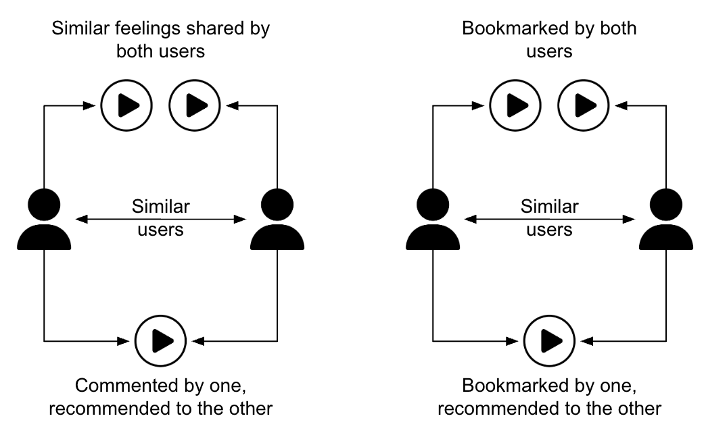
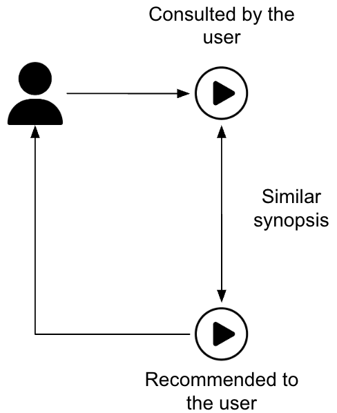
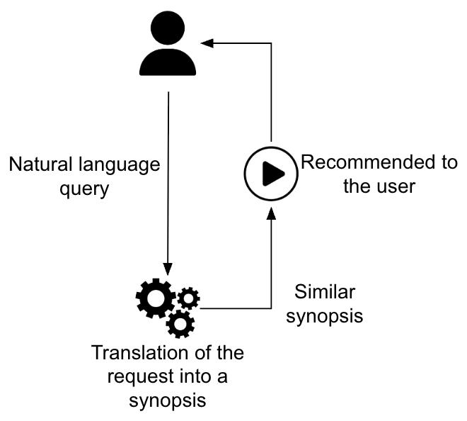
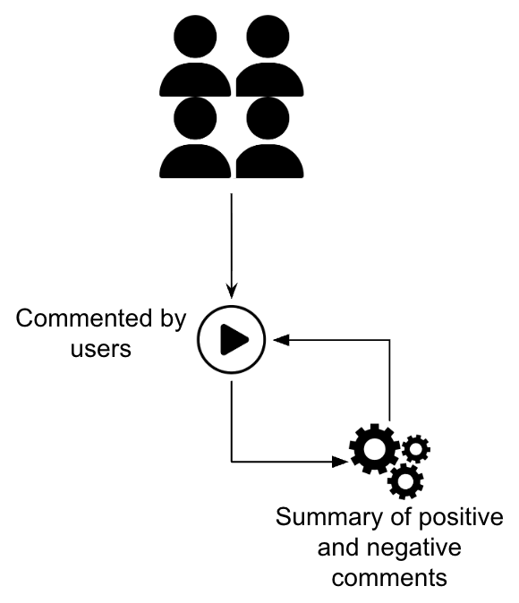
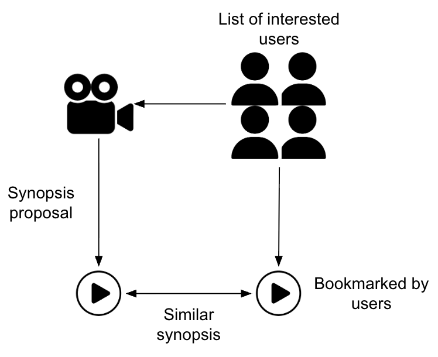

# Anime recommendation engine 🏯

   

## Context

MyAnimeList is a community platform for sharing anime. It allows users to view anime descriptions, rate them, comment on them, and create their own watch lists.

The site has approximately 47,000 registered users and attracts millions of unregistered visitors.

MyAnimeList therefore needs to improve the user experience by offering personalized recommendations and other features to encourage registrations.

This app provides personalized anime recommendations and other features using NLP (all features are described below.)

## Web pages

[Web interface](https://qxzjy-streamlit-anime-recommandation-engine.hf.space) (Streamlit)

## Features

### EDA
An analysis of the [MyAnimeList dataset](https://www.kaggle.com/datasets/marlesson/myanimelist-dataset-animes-profiles-reviews) 

### Collaborative filtering
Suggestions are based on what you've watched, liked, and commented on, as well as the preferences of similar users.

   

**Technological stack :** sentiments analysis and ALS.

### Content-based filtering
Recommendations are made by analyzing the content of anime descriptions to find similar titles.

   

**Technological stack :** embedding and cosine similarity.

### Describe filtering
"Tell us what you want — or don’t want — and we’ll recommend the perfect anime !"

   

**Technological stack :** prompt engineering, embedding and cosine similarity.

### Review summarization
An AI generated review based on all users's reviews.

   

**Technological stack :** prompt engineering.

### Diffusion list for new content
A generated list of users based on the new synopsis and their favorite animes.

   

**Technological stack :** embedding and cosine similarity.

## Getting Started (development environment)

To deploy the app locally  :
1. Clone the repository :\
`$ git clone https://github.com/qxzjy/anime-recommendation-engine.git`
2. Go to the repository :\
`$ cd anime-recommendation-engine`
3. Add your MISTRAL_API_KEY in your environnement variable :\
`$ export MISTRAL_API_KEY=your_key`
4. Launch the steamlit app :\
`$ streamlit run app.py`

To deploy the app with DockerHub image :\
`$ docker run -p 8501:8501 -v $(pwd):/app -e MISTRAL_API_KEY=$MISTRAL_API_KEY lyxor/anime-recommendation-engine`

## Authors

[Maxime RENAULT](https://github.com/qxzjy)\
[Marjorie JANDA](https://github.com/Marjorie-J)\
[Antoine OGER](https://github.com/AntOG96)\
[Florent PROUST](https://github.com/LyXoR51)
